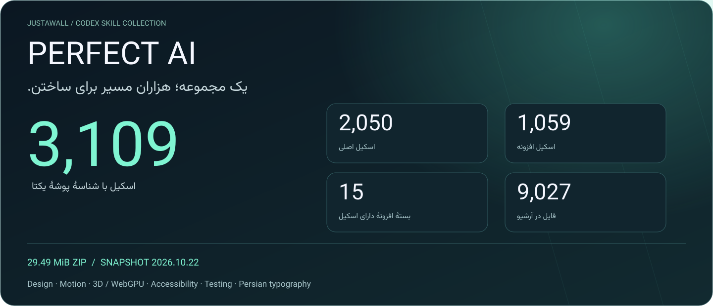
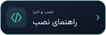

<div align="center">



**مجموعهٔ اسکیل‌های Codex برای طراحی، موشن، سه‌بعدی، دسترس‌پذیری، مرورگر، تست و تایپوگرافی فارسی.**

<a href="https://github.com/Realjustawall/Perfect-AI/releases/latest/download/Perfect-AI-2026.10.22.zip"></a>
<a href="FINAL-INDEX-ALL-SKILLS-FA.md"></a>
<a href="#installation"></a>
<a href="https://github.com/Realjustawall/Perfect-AI/issues"></a>

[English](README.md) · [فارسی](README.fa.md)

</div>

---

## مشخصات دقیق مجموعه

| معیار | مقدار بررسی‌شده |
|---|---:|
| فایل اسکیل (`SKILL.md`) | **۳۱۰۹** |
| شناسهٔ یکتای پوشهٔ اسکیل | **۳۱۰۹** |
| اسکیل اصلی | **۲۰۵۰** |
| اسکیل در افزونه‌ها | **۱۰۵۹** |
| بستهٔ افزونهٔ دارای اسکیل | **۱۵** |
| فایل در ZIP اصلی | **۹۰۲۷** |
| حجم ZIP اصلی | **۲۹٫۴۹ MiB** / ۳۰٬۹۱۷٬۴۷۸ بایت |
| تاریخ نسخه | **۲۰۲۶٫۱۰٫۲۲** |

این اعداد مستقیماً از فایل ارسالی استخراج شده و صحت CRC و SHA-256 بررسی شده است. هر اسکیل یک بستهٔ دستورالعمل است؛ تعداد اسکیل‌ها به معنی اجرای عملی تمام ابزارها، اتصال‌های GPU یا نمونه‌ها نیست.

## چه چیزهایی در مجموعه هست؟

| حوزه | محتوا |
|---|---|
| طراحی محصول و ظاهر | چیدمان، سیستم طراحی، رابط واکنش‌گرا، کامپوننت و گردش‌کارهای مرجع. |
| موشن و تعامل | دستورالعمل انیمیشن، موشن سینمایی، تعامل ایزومتریک و ژست‌ها. |
| سه‌بعدی و گرافیک | راهنمای Three.js و WebGPU، نمونه‌ها و رندر. |
| کیفیت | تست مرورگر، دسترس‌پذیری، عملکرد، بازبینی و ممیزی انتشار. |
| تایپوگرافی فارسی | مجوز فونت، پوشش حروف، اتصال، راست‌به‌چپ و بررسی بصری. |
| همکاری عامل‌ها | نقش‌ها، هماهنگی، مالکیت فایل و قالب تحویل کار. |

[فهرست کامل اسکیل‌ها](FINAL-SKILLS-MANIFEST.json) و [نمایهٔ دسته‌بندی‌شده](FINAL-INDEX-ALL-SKILLS-FA.md) در دسترس‌اند. برای هستهٔ مجموعه به سرور MCP نیاز نیست؛ بعضی اتصال‌ها به بسته، ابزار، حساب یا سخت‌افزار جداگانه نیاز دارند. وجود فایل نقش، به‌تنهایی عامل موازی اجرا نمی‌کند.

<a id="installation"></a>

## نصب

### ویندوز و PowerShell — هر ۳۱۰۹ اسکیل

۱. بستهٔ کامل را از دکمهٔ دریافت دانلود و استخراج کنید.
۲. PowerShell را در پوشه‌ای باز کنید که `install/` و `skills/` داخل آن‌اند.
۳. ابتدا پیش‌نمایش نصب را برای پروژهٔ موجود ببینید:

```powershell
.\install\install-perfect-ai.ps1 -ProjectPath "C:\Projects\MySite"
```

برای اعمال نصب و کپی اختیاری دارایی‌های افزونه‌ها:

```powershell
.\install\install-perfect-ai.ps1 -ProjectPath "C:\Projects\MySite" -Execute -CopyExtensionAssets
```

اسکیل‌ها در `.agents/skills` پروژه قرار می‌گیرند؛ پوشه‌های موجود بازنویسی نمی‌شوند. با گزینهٔ مربوط، دارایی افزونه‌ها در `.perfect-ai/extensions` قرار می‌گیرد. سپس Codex را دوباره باز کنید و `$perfect-ai-master` را فراخوانی کنید.

### لینوکس و macOS — نصب‌کنندهٔ هسته

```bash
bash install/install-codex.sh /absolute/path/to/your/project
```

نصب‌کنندهٔ Bash فقط **۲۰۵۰ اسکیل اصلی** را نصب می‌کند و پوشه‌های موجود را رد می‌کند. برای نصب کل مجموعه با نصب‌کنندهٔ همراه، PowerShell 7 و فایل `install/install-perfect-ai.ps1` را با پارامترهای بالا اجرا کنید.

## بررسی صحت نسخه

در نسخهٔ کلون‌شدهٔ مخزن که سه بخش آرشیو را دارد:

```bash
python tools/verify-distribution.py
```

این دستور هش فایل‌های توزیع، تعداد اسکیل‌ها، بخش‌های آرشیو و هش ZIP بازسازی‌شده را بررسی می‌کند. ZIP اصلی نیز بدون تغییر بایت‌ها به‌شکل یک فایل در ریلیز قرار می‌گیرد.

**SHA-256 فایل ZIP اصلی**

```text
b59d684a098da51ca397fe7499dda348945316c56e8f05c2f0fc2f1ab2c55ffd
```

فایل‌های `PERFECT-AI-CURRENT-SHA256.json` و `SHA256SUMS.txt` و گزارش‌های قدیمی برای سابقه حفظ شده‌اند؛ برخی افزوده‌های جدید در آن‌ها نیست. مرجع این نسخهٔ مخزن [distribution-manifest.json](distribution-manifest.json) است. دو README اصلی داخل فایل ارسالی هم در [docs/archive](docs/archive) نگه داشته شده‌اند.

## مستندات و نمونه‌ها

- [فهرست کامل مسیر اسکیل‌ها](FINAL-SKILLS-MANIFEST.json)
- [نمایهٔ فارسی همهٔ اسکیل‌ها](FINAL-INDEX-ALL-SKILLS-FA.md)
- [سورس نصب‌کننده](install/install-perfect-ai.ps1)
- [پروژه‌های نمونه](examples)
- [بسته‌های افزونه و منابع جانبی](extensions)
- [راهنمای فریم‌ورک‌ها](frameworks)
- [منشأ و مجوز منابع ثالث](ORIGIN-AND-LICENSES.md)
- [README فارسی اصلی فایل ارسالی](docs/archive/README-FA.uploaded.md)
- [گزارش این نسخه](docs/RELEASE-2026.10.22.md)

## حقوق و بازخورد

ساخت و گردآوری توسط **[JustAWall / @Realjustawall](https://github.com/Realjustawall)**. حقوق و مجوز محتوای ثالث متعلق به صاحبان آن است؛ این مجموعه مجوز تازه‌ای برای پروژه‌های خارجی ایجاد نمی‌کند. فونت تصاویر Vazirmatn نسخهٔ 33.003 با مجوز [OFL-1.1](docs/assets/Vazirmatn-OFL.txt) است؛ متن SVG به شکل حروف تبدیل شده تا اتصال فارسی مستقل از فونت دستگاه حفظ شود.

[گزارش اشکال](https://github.com/Realjustawall/Perfect-AI/issues) را همراه تاریخ نسخه، شناسهٔ اسکیل و روش بازتولید بنویسید؛ اطلاعات خصوصی پروژه و کلیدها را ارسال نکنید.
