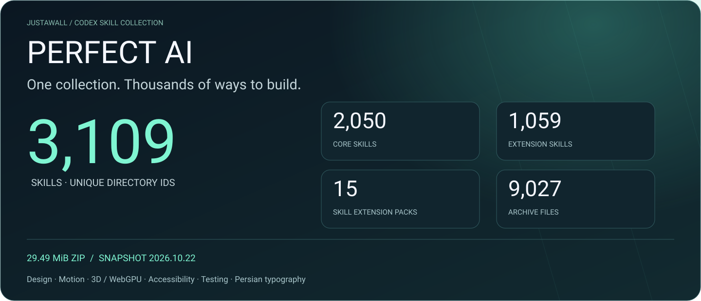

<div align="center">



**A Codex skill collection for design, motion, 3D, accessibility, browser workflows, testing and Persian typography.**

<a href="https://github.com/Realjustawall/Perfect-AI/releases/latest/download/Perfect-AI-2026.10.22.zip"></a>
<a href="FINAL-INDEX-ALL-SKILLS-FA.md"></a>
<a href="#installation"></a>
<a href="https://github.com/Realjustawall/Perfect-AI/issues"></a>

[English](README.md) · [فارسی](README.fa.md)

</div>

---

## The collection, counted

| Metric | Verified value |
|---|---:|
| Skill files (`SKILL.md`) | **3,109** |
| Unique skill directory IDs | **3,109** |
| Core skills | **2,050** |
| Extension skills | **1,059** |
| Extension packs containing skills | **15** |
| Files in the original ZIP | **9,027** |
| Original ZIP size | **29.49 MiB** / 30,917,478 bytes |
| Snapshot | **2026.10.22** |

These are direct counts from the uploaded distribution, with CRC and SHA-256 checks. A skill is an instruction package; counts do not imply that every external tool, GPU integration or recipe was runtime tested.

## What you can build

| Area | Included material |
|---|---|
| Product and visual design | Layout, design systems, responsive interfaces, components and reference workflows. |
| Motion and interaction | Animation recipes, cinematic motion, isometric interactions and gesture handling. |
| 3D and graphics | Three.js / WebGPU workflows, graphics examples and rendering guidance. |
| Quality | Browser testing, accessibility, performance, review and release audit guides. |
| Persian typography | Font licensing, glyph coverage, shaping, RTL/LTR and visual verification guides. |
| Agent collaboration | Role profiles, orchestration instructions, file ownership and handoff formats. |

Browse the [complete skill inventory](FINAL-SKILLS-MANIFEST.json) or [categorized Persian index](FINAL-INDEX-ALL-SKILLS-FA.md). No MCP server is required for the core collection. Individual integrations may require their own packages, tools, accounts or hardware; role files do not automatically start subagents.

<a id="installation"></a>

## Installation

### Windows / PowerShell — all 3,109 skills

1. Download and extract the complete package using the button above.
2. Open PowerShell in the extracted folder containing `install/` and `skills/`.
3. Preview the installation into an existing project:

```powershell
.\install\install-perfect-ai.ps1 -ProjectPath "C:\Projects\MySite"
```

Apply it and optionally copy extension assets:

```powershell
.\install\install-perfect-ai.ps1 -ProjectPath "C:\Projects\MySite" -Execute -CopyExtensionAssets
```

Skills go into the project's `.agents/skills`. Existing skill directories are skipped. Extension assets go into `.perfect-ai/extensions` when requested. Restart Codex, then invoke `$perfect-ai-master`.

### Linux / macOS — core installer

```bash
bash install/install-codex.sh /absolute/path/to/your/project
```

The Bash installer installs **the 2,050 core skills only** and skips existing directories. To install the complete set with the supplied installer, use PowerShell 7 and `install/install-perfect-ai.ps1` with the same parameters shown above.

## Verify the distribution

From a clone of this repository with the archive parts present:

```bash
python tools/verify-distribution.py
```

This checks all tracked payload hashes, skill counts, the three archive parts and the exact reconstructed ZIP hash. The original archive is also published as one downloadable release asset, byte-for-byte unchanged.

**Original ZIP SHA-256**

```text
b59d684a098da51ca397fe7499dda348945316c56e8f05c2f0fc2f1ab2c55ffd
```

The original `PERFECT-AI-CURRENT-SHA256.json`, `SHA256SUMS.txt` and earlier audit records are preserved for history. They predate some additions and are not the complete manifest for this snapshot. Use [distribution-manifest.json](distribution-manifest.json) for the current repository. The two original uploaded READMEs are preserved in [docs/archive](docs/archive).

## Documentation and examples

- [Complete skill path inventory](FINAL-SKILLS-MANIFEST.json)
- [All skills index in Persian](FINAL-INDEX-ALL-SKILLS-FA.md)
- [Installer source](install/install-perfect-ai.ps1)
- [Example projects](examples)
- [Extension packs and support resources](extensions)
- [Framework guides](frameworks)
- [Third-party provenance and licenses](ORIGIN-AND-LICENSES.md)
- [Original uploaded English README](docs/archive/README.uploaded.md)
- [Release and verification notes](docs/RELEASE-2026.10.22.md)

## Rights and feedback

Created and curated by **[JustAWall / @Realjustawall](https://github.com/Realjustawall)**. Third-party content retains its original copyright and license conditions; this distribution does not grant rights to external projects. Vazirmatn artwork uses version 33.003 under [OFL-1.1](docs/assets/Vazirmatn-OFL.txt); SVG text is shaped and converted to glyph outlines for consistent Persian rendering.

[Report an issue](https://github.com/Realjustawall/Perfect-AI/issues) with the snapshot, skill ID and reproduction steps. Keep credentials and private project files out of reports.
